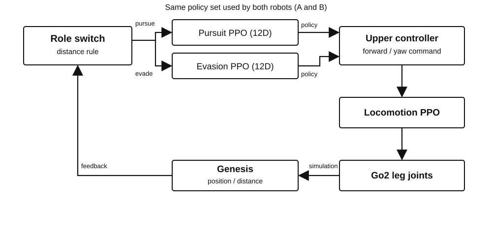

# 同一AIを搭載した2体のロボットは、互いを追跡するか？

**Physical AI 応用編1｜最終課題**

Genesisシミュレーション環境で、2体の四足歩行ロボット「Unitree Go2」による相互追跡を検証しました。

歩行制御と追跡・回避制御に階層型PPOを採用し、相手との距離に応じて追跡役と回避役が交代する仕組みを構築しています。

最終実験では、**手動の旋回制限を使用せず、60秒間で8回の役割交代**を確認しました。

[実験動画（YouTube）](https://youtu.be/qfH1FF0X7BM)

## 1. システム構成

2体のロボットは同じ制御構成と学習済みモデル群を使用します。

| 構成要素 | 役割 |
|---|---|
| 下位PPO | 12脚関節による四足歩行 |
| 上位PPO（追跡） | 相手に接近するための移動指令 |
| 上位PPO（回避） | 相手から離れるための移動指令 |
| 役割交代ロジック | 2体間距離に応じた追跡役・回避役の切り替え |
| Genesis | ロボットの物理シミュレーション |
| PyBullet | Genesisで記録した関節姿勢の3D描画 |

追跡と回避には、それぞれ別々に学習したPPO方策を使用します。役割交代そのものは強化学習ではなく、距離閾値によるルール制御です。

## 2. 開発・改善の過程

本研究では、四足歩行の獲得から始め、2体の相互追跡、姿勢情報の追加、PPOの追加学習へと段階的に開発を進めました。

| 段階 | 取り組み | 得られた結果・課題 |
|---|---|---|
| ① 四足歩行 | 下位PPOによる脚関節制御 | Go2の歩行動作を確認 |
| ② 相互追跡 | 追跡・回避方策と距離による役割交代 | 60秒間・4回の役割交代を確認。ただし手動旋回制限に依存 |
| ③ 姿勢情報の拡張 | 上位PPOの観測を8Dから12Dへ拡張 | Roll・Pitch・角速度を観測に追加 |
| ④ 追加学習 | Genesisで収集したデータを用いて上位PPOを更新 | 姿勢情報を含む方策へ改善 |
| ⑤ 最終評価 | 手動旋回制限なしで2体を動作 | 60秒間・8回の役割交代を確認 |

初期の相互追跡実験では、手動で旋回指令を制限することで安定動作を得ていました。しかし、この方法では、学習済み方策そのものが安定した旋回を獲得したとはいえません。

そこで、上位PPOの観測に機体姿勢と角速度を追加し、Genesis上での追加学習を実施しました。**最終結果だけでなく、制御上の問題を発見し改善した過程も本研究の重要な成果です。**

## 3. 最終実験結果

実行条件は、Google ColabのNVIDIA L4 GPU、Genesis 1.4.4、シミュレーション刻み20ms、近距離初期配置です。

| 評価項目 | 結果 |
|---|---:|
| 実行時間 | 60.00秒 |
| シミュレーションステップ | 3,000 |
| 役割交代回数 | 8回 |
| 手動旋回制限 | なし |
| 最終2体間距離 | 0.523m |
| 最大絶対Roll | 4.72° |
| 最大絶対Pitch | 7.01° |
| 最低機体高さ | 0.197m |
| 記録データ | 6,000行（2体×3,000ステップ） |

公開済みの評価Notebookを用いたL4環境での再実行でも、60秒完走と8回の役割交代を確認しました。

一方、T4環境での実行では29.1秒時点で機体高さによる安全停止が発生しています。GPU差が原因であると断定できる結果ではありません。

今回の結果は特定の初期配置で得られたものであり、さまざまな条件下での安定性を保証するものではありません。

## 4. 実行環境

| 項目 | 環境 |
|---|---|
| 実行基盤 | Google Colab / NVIDIA L4 |
| シミュレータ | Genesis 1.4.4 |
| 強化学習 | PPO / RSL-RL 5.5.1 |
| 機械学習 | PyTorch |
| プログラミング言語 | Python |
| 動画描画 | PyBullet |

物理シミュレーションとロボット制御はGenesisで実行しています。PyBulletは記録済みの動作をGo2のURDFモデルで描画するために使用しました。

## 5. 公開ファイルと再現方法

| ディレクトリ | 内容 |
|---|---|
| [`models/`](models/) | 下位歩行PPO、上位追跡PPO、上位回避PPO、設定ファイル |
| [`notebooks/`](notebooks/) | Genesis最終評価、記録データの3D描画 |
| [`scripts/`](scripts/) | モデルファイルと評価結果の検証 |
| [`docs/`](docs/) | システム構成図、実験結果、再現手順、モデル情報 |

主なファイル：

- [`notebooks/56_genesis_60s_3d_dot_video.ipynb`](notebooks/56_genesis_60s_3d_dot_video.ipynb) — Genesisによる60秒評価
- [`notebooks/57_go2_urdf_render_from_phase56.ipynb`](notebooks/57_go2_urdf_render_from_phase56.ipynb) — 記録データの3D描画
- [`scripts/verify_model_artifacts.py`](scripts/verify_model_artifacts.py) — モデルファイルの確認
- [`scripts/verify_phase56_results.py`](scripts/verify_phase56_results.py) — 評価結果データの検証
- [`docs/reproduction.md`](docs/reproduction.md) — 実行・検証手順
- [`docs/model_manifest.md`](docs/model_manifest.md) — 学習済みモデルの構成
- [`docs/experiment_summary.md`](docs/experiment_summary.md) — 実験結果と制約

学習済みモデルと設定ファイルは公開しています。ただし、評価NotebookにはGoogle Drive上の開発時のファイル配置を参照する部分があり、実行環境に応じたパス調整が必要です。

**第三者による学習から評価までの完全な再現は、現時点では検証できていません。**

本リポジトリは、最終評価とその結果の確認を中心に公開しています。学習過程の主要Notebookは公開用に整理していないため、学習からの再現には追加の作業が必要です。

## 6. 考察と今後の課題

今回、手動旋回制限を使用せずに60秒間の相互追跡を実現しました。一方で、次の課題が残っています。

- 歩行姿勢と動作の自然さの改善
- 機体高さの低下や転倒リスクへの対応
- 初期位置や摩擦条件を変更した複数回評価
- 8Dと12Dの学習済み方策による比較検証
- 長時間動作と異なる実行環境での再現性確認

特に、12Dへの拡張と追加学習を実施したものの、**12D姿勢入力が安定性向上にどの程度寄与したかは、比較実験による検証が必要**です。

## 7. 生成AIの活用

設計・実装・検証の過程で、生成AIを補助的に活用しました。ロボット制御には強化学習（PPO）を使用しています。実験の実施、結果の評価、開発方針の決定は制作者が行いました。

## 8. クレジット

- 講座：東京大学 松尾・岩澤研究室「Physical AI講座2026 応用編1」
- ロボットモデル：Unitree Robotics / Unitree Go2
- シミュレーション：[Genesis](https://github.com/Genesis-Embodied-AI/Genesis)
- 強化学習：[RSL-RL](https://github.com/leggedrobotics/rsl_rl)
- 機械学習：[PyTorch](https://pytorch.org/)
- 3D描画：[PyBullet](https://pybullet.org/)
- 実行環境：Google Colab

各ソフトウェアおよびモデルの権利は、それぞれの権利者に帰属します。本プロジェクトは、上記組織・企業による公式な共同開発や承認を意味するものではありません。
